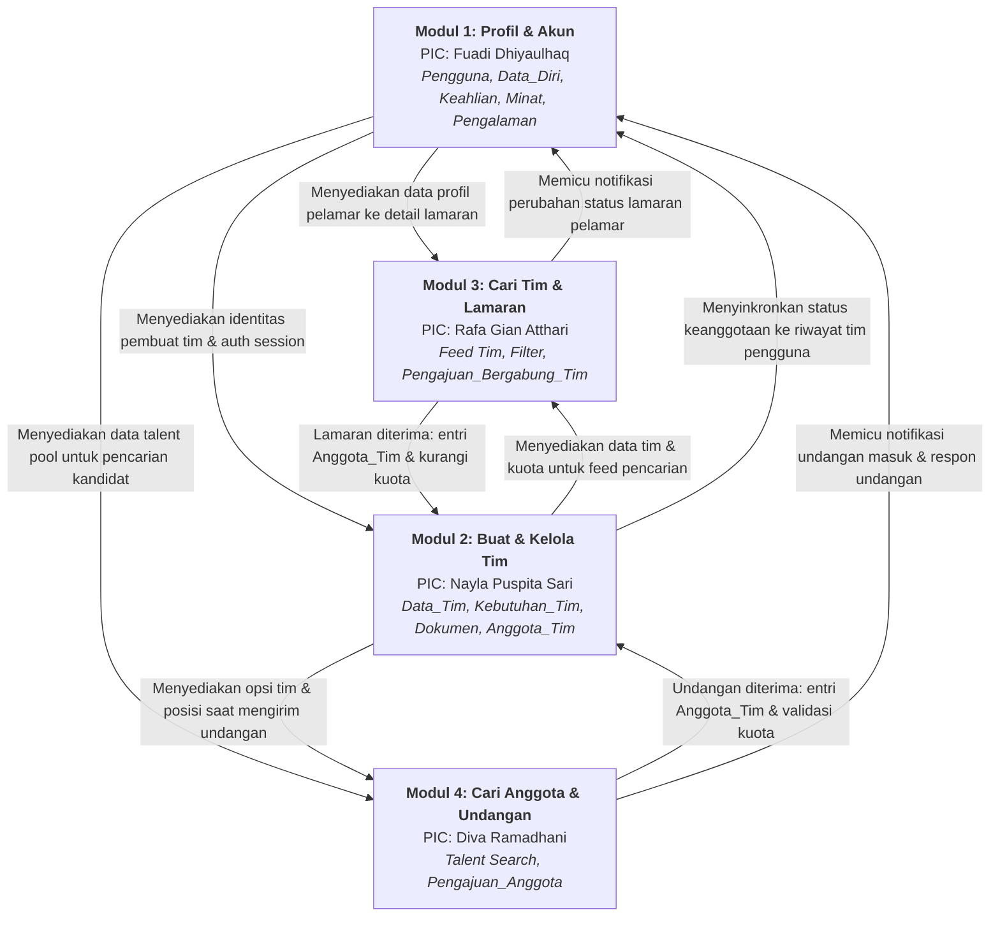

# PROJECT PRD
## Product Requirements Document

---

### Meta Information

| Metadata | Details |
| :--- | :--- |
| **Project Name** | MyTeam – Aplikasi Mobile Pencarian dan Pembentukan Tim Mahasiswa Unand |
| **Team Members & PIC** | 1. **Fuadi Dhiyaulhaq** (2411522001) — *PIC Modul 1* 2. **Nayla Puspita Sari** (2411521007) — *PIC Modul 2* 3. **Rafa Gian Atthari** (2411522014) — *PIC Modul 3* 4. **Diva Ramadhani** (2411521017) — *PIC Modul 4* |
| **Course** | Mobile Programming |
| **Version** | 1.1 (Revised Flow & Module Architecture) |
| **Date** | 17 Oktober 2026 |

---

## Tujuan Dokumen
PRD ini digunakan untuk menjelaskan apa yang akan dibangun, untuk siapa, mengapa produk dibutuhkan, pembagian tanggung jawab per modul (PIC), spesifikasi alur pengguna ber-kode, serta kebutuhan utama aplikasi MyTeam tanpa menjelaskan detail implementasi kode yang rumit.

---

## 1. Problem & Users

### 1.1 Problem Statement
Mahasiswa Universitas Andalas yang ingin mengikuti kegiatan yang membutuhkan pembentukan tim masih kesulitan menemukan tim atau anggota yang sesuai dengan minat, keahlian, dan pengalaman. Informasi mengenai mahasiswa yang mencari tim maupun mahasiswa yang membutuhkan anggota masih tersebar di berbagai grup dan media komunikasi, sehingga proses pencarian dan pembentukan tim menjadi kurang efektif. Kondisi ini dapat menyebabkan mahasiswa kehilangan kesempatan untuk berpartisipasi dalam kegiatan yang sesuai dengan minat, keahlian, dan pengalamannya.

### 1.2 Target Users
Pengguna utama MyTeam adalah mahasiswa aktif Universitas Andalas yang ingin mengikuti kegiatan yang membutuhkan pembentukan tim, seperti lomba, penelitian, proyek, atau kegiatan lainnya. Pengguna memiliki dua peran, yaitu pencari tim yang ingin menemukan dan bergabung dengan tim sesuai dengan minat, keahlian, dan pengalamannya, serta pencari anggota (pembuat tim) yang telah memiliki ide, kesempatan, atau tim dan membutuhkan anggota dengan keahlian tertentu. Satu mahasiswa dapat memiliki kedua peran tersebut sesuai dengan kegiatan yang diikuti.

### 1.3 User Needs / Pain Points
- Mahasiswa membutuhkan cara yang lebih mudah untuk menemukan tim atau calon anggota yang sesuai dengan minat, keahlian, pengalaman, dan kebutuhan suatu kegiatan.
- Mahasiswa membutuhkan jangkauan pencarian yang lebih luas untuk menemukan tim atau calon anggota di luar lingkungan pertemanan, kelas, dan organisasi.
- Mahasiswa membutuhkan informasi profil, pendidikan, minat, keahlian, dan pengalaman beserta deskripsinya untuk menilai kesesuaian dengan tim atau calon anggota.
- Mahasiswa membutuhkan proses yang jelas untuk membuat tim, mencari tim atau calon anggota, mengajukan diri untuk bergabung, mengajukan permintaan kepada calon anggota, serta menerima atau menolak pengajuan.
- Mahasiswa membutuhkan informasi mengenai status pengajuan agar dapat mengetahui apakah pengajuan bergabung masih menunggu, diterima, atau ditolak.

### 1.4 Project Goal
MyTeam bertujuan menyediakan aplikasi mobile bagi mahasiswa Universitas Andalas untuk menemukan, membentuk, dan bergabung dengan tim berdasarkan minat, keahlian, pengalaman, dan kebutuhan kegiatan. Aplikasi ini diharapkan dapat mempermudah dan mempercepat proses pencarian serta pembentukan tim, sehingga mahasiswa dapat menemukan rekan yang sesuai dan berpartisipasi dalam berbagai kegiatan yang membutuhkan pembentukan tim.

---

## 2. Product Requirements

### 2.1 Functional Requirements (Berdasarkan PIC Modul)

#### Modul 1: Pengelolaan Data Riwayat Diri (Profil) & Autentikasi — PIC: Fuadi Dhiyaulhaq
- **FR-01:** Pengguna dapat mengelola data diri berupa deskripsi singkat, kontak, program studi, fakultas, dan IPK.
- **FR-02:** Pengguna dapat mengelola media sosial berupa nama media sosial dan tautannya.
- **FR-03:** Pengguna dapat mengelola minat berupa nama minat dan deskripsinya.
- **FR-04:** Pengguna dapat mengelola keahlian berupa nama keahlian dan deskripsinya.
- **FR-05:** Pengguna dapat mengelola pengalaman berupa nama kegiatan, peran, tahun, dan deskripsi pengalaman.
- **FR-06:** Pengguna dapat melihat informasi tim yang diikuti berupa nama tim, nama kegiatan, kategori kegiatan, dan posisi.
- **FR-07:** Sistem dapat mengirimkan notifikasi terkait aktivitas data riwayat diri (pembaruan data profil).

#### Modul 2: Pembuatan dan Pengelolaan Tim — PIC: Nayla Puspita Sari
- **FR-08:** Pengguna dapat membuat tim baru dengan mengisi informasi tim (nama tim, kegiatan, kategori, deskripsi, kebutuhan posisi) dan mengunggah dokumen pendukung seperti poster atau panduan kegiatan secara native.
- **FR-09:** Pengguna dapat melihat daftar tim yang dibuatnya dan tim yang diikutinya sebagai anggota, serta melihat detail tim tersebut. Aksi mengubah dan menghapus tim hanya tersedia bagi pemilik tim.
- **FR-10:** Pengguna dapat mengubah informasi dan dokumen pendukung pada tim yang telah dibuat, kecuali kategori kegiatan.
- **FR-11:** Pengguna dapat menghapus tim yang telah dibuat beserta dependensi terkaitnya.
- **FR-12:** Pengguna (pembuat tim) menerima notifikasi ketika terdapat pengajuan bergabung ke tim yang dibuatnya.

#### Modul 3: Pencarian Tim & Pengajuan Bergabung — PIC: Rafa Gian Atthari
- **FR-13:** Pengguna sebagai pencari tim dapat melihat feed tim atau kegiatan terbaru yang tersedia.
- **FR-14:** Pengguna sebagai pencari tim dapat melakukan pencarian dan penyaringan tim berdasarkan nama kegiatan, kategori kegiatan, keahlian yang dibutuhkan, dan kriteria lainnya.
- **FR-15:** Pengguna sebagai pencari tim dapat melihat detail tim dari hasil pencarian (termasuk deskripsi, poster/panduan, posisi tersedia).
- **FR-16:** Pengguna sebagai pencari tim dapat mengajukan permintaan untuk bergabung ke tim yang dipilih dengan menyertakan posisi yang dilamar dan pesan pengajuan.
- **FR-17:** Pembuat tim dapat melihat daftar pengajuan bergabung ke tim yang dibuatnya.
- **FR-18:** Pembuat tim dapat melihat detail pengajuan bergabung (posisi dilamar, pesan pengajuan, dan kartu profil ringkas calon anggota).
- **FR-19:** Pembuat tim dapat menerima atau menolak pengajuan bergabung.
- **FR-20:** Pengguna dapat melihat status pengajuan bergabung dan menerima notifikasi ketika status pengajuan berubah (menunggu, diterima, ditolak).

#### Modul 4: Pencarian Anggota & Pengajuan Anggota (Talent Scouting & Undangan) — PIC: Diva Ramadhani
- **FR-21:** Pengguna sebagai pencari anggota dapat mencari calon anggota dengan kata kunci nama, program studi, atau NIM; memfilter berdasarkan keahlian dan minat; serta melihat jumlah pengalaman yang dimiliki setiap calon anggota.
- **FR-22:** Pengguna sebagai pencari anggota dapat melihat detail profil calon anggota dari hasil pencarian untuk menilai kecocokan.
- **FR-23:** Pembuat tim dapat mengundang calon anggota dengan memilih posisi yang masih memiliki kuota pada tim miliknya dan mengirimkan pesan undangan.
- **FR-24:** Calon anggota dapat melihat detail tim dan posisi yang ditawarkan pada undangan, lalu menerima atau menolak undangan. Jika diterima dan kuota posisi masih tersedia, calon anggota langsung ditambahkan sebagai anggota tim pada posisi tersebut. Jika kuota telah penuh ketika undangan diterima, sistem otomatis mengubah status undangan menjadi ditolak (kuota penuh).
- **FR-24b:** Pembuat tim dapat melihat daftar undangan terkirim beserta posisi yang ditawarkan dan statusnya.
- **FR-25:** Calon anggota menerima notifikasi ketika mendapat undangan, dan pembuat tim menerima notifikasi ketika calon anggota merespons (menerima atau menolak) undangan.

### 2.2 Non-functional Requirements
- **NFR-01:** Halaman utama harus dapat ditampilkan dalam waktu ≤ 3 detik pada kondisi jaringan normal.
- **NFR-02:** Hasil pencarian harus dapat ditampilkan dalam waktu ≤ 3 detik setelah pengguna memasukkan kata kunci atau menerapkan filter pada kondisi jaringan normal.
- **NFR-03:** Antarmuka aplikasi harus mudah digunakan oleh mahasiswa Universitas Andalas tanpa memerlukan pelatihan khusus.
- **NFR-04:** Aplikasi harus dapat berjalan pada perangkat dengan sistem operasi Android versi minimal 8.0 (API Level 26).
- **NFR-05:** Data pengguna harus dapat diakses dan ditampilkan sesuai dengan hak akses yang ditentukan oleh sistem.
- **NFR-06:** Data aplikasi harus disimpan menggunakan database yang mendukung pertukaran data antarpengguna dan tidak menggunakan Firebase Storage.
- **NFR-07:** Sistem harus menjaga konsistensi data pengguna, data diri, tim, kebutuhan tim, dokumen pendukung, anggota tim, pengajuan bergabung tim, pengajuan anggota, dan notifikasi ketika terjadi perubahan data, termasuk ketika tim dihapus (*cascading consistency*).
- **NFR-08:** Sistem harus dapat mengirimkan notifikasi setelah aktivitas yang memicu notifikasi berhasil diproses pada kondisi jaringan normal.
- **NFR-09:** Setiap modul harus terintegrasi dengan modul lainnya dan dapat digunakan melalui alur utama aplikasi.

### 2.3 Core Features & PIC Modul

| No. | Modul & PIC | Core Feature | Ruang Lingkup & Value |
| :---: | :--- | :--- | :--- |
| **M1** | **Modul 1: Fuadi Dhiyaulhaq** *(2411522001)* | **Akun & Data Riwayat Diri (Profil)** | Memungkinkan mahasiswa membuat akun (autentikasi NIM) dan mengelola profil akademik (IPK, kontak, prodi, fakultas), keahlian, minat, portofolio pengalaman (kegiatan, peran, tahun, deskripsi), tautan media sosial, serta melihat daftar riwayat tim yang diikuti. Menjadi fondasi data (*single identity*) untuk seluruh modul. |
| **M2** | **Modul 2: Nayla Puspita Sari** *(2411521007)* | **Pembuatan & Pengelolaan Tim** | Memungkinkan mahasiswa membuat tim baru dengan mendefinisikan kebutuhan posisi & kuota, mengunggah dokumen pendukung (poster/panduan lomba) via native file picker, melihat detail tim sendiri, mengedit informasi tim, dan menghapus tim beserta pembatalan dependensi terkait. |
| **M3** | **Modul 3: Rafa Gian Atthari** *(2411522014)* | **Pencarian Tim & Pengajuan Bergabung** | Memfasilitasi pencari tim melalui feed tim terkini, pencarian & filter multi-kriteria (kategori kegiatan, skill), peninjauan detail tim, pengajuan lamaran bergabung (*apply* posisi & pesan), pemantauan status lamaran, serta manajemen persetujuan/penolakan lamaran oleh pembuat tim. |
| **M4** | **Modul 4: Diva Ramadhani** *(2411521017)* | **Pencarian Anggota & Pengajuan Anggota** | Memfasilitasi pembuat tim dalam *talent scouting* calon anggota berdasarkan nama, NIM, program studi, keahlian, minat, atau pengalaman; melihat detail portofolio calon anggota; mengirim undangan bergabung (*invitation*) dengan memilih tim dan posisi yang tersedia; memantau status undangan terkirim; serta memfasilitasi calon anggota untuk menerima/menolak undangan dengan validasi kuota otomatis. |

---

### 2.4 User Flow (Koreksi & Kodifikasi Terstruktur)

> **Catatan Klarifikasi Alur:**
> Pada draft sebelumnya terdapat 5 butir karena butir *"Pencari Anggota (mengirim undangan)"* terduplikasi secara tidak sengaja. Pada aplikasi MyTeam, secara fundamental terdapat **2 Peran Pengguna** (*Pencari Anggota* dan *Pencari Tim*) dengan **4 Jalur Alur Utama (2 Peran × 2 Arah Alur)**.
> Setiap alur kini dibakukan dengan kode unik resmi (**UF-01 s.d UF-04**) beserta rincian sub-langkah dan modul penanggung jawabnya:

#### A. Peran: Pencari Anggota (Pembuat Tim)

##### [UF-01] Pencari Anggota: Menerima Pengajuan Masuk (Inbound Application)
Alur ketika pembuat tim membuka lowongan anggota, menerima lamaran dari pencari tim yang tertarik, menyeleksi kandidat, dan menerima anggota ke dalam tim.

* **UF-01.1** [Modul 1]: Buka Aplikasi & Login menggunakan NIM/Kata Sandi.
* **UF-01.2** [Modul 2]: Navigasi ke menu Tim Saya → Klik tombol *"Buat Tim Baru"*.
* **UF-01.3** [Modul 2]: Mengisi data tim (nama kegiatan, kategori lomba/riset, deskripsi, form posisi yang dibutuhkan & kuota) dan mengunggah poster/panduan lomba.
* **UF-01.4** [Modul 2]: Tim berhasil dibuat dan berstatus aktif/terbuka (*open recruitment*).
* **UF-01.5** [Modul 3]: Menerima notifikasi bahwa ada mahasiswa yang mengajukan diri bergabung ke tim.
* **UF-01.6** [Modul 3]: Membuka daftar pengajuan bergabung (*applicant list*) pada detail tim terkait.
* **UF-01.7** [Modul 1 & 3]: Melihat rincian pengajuan (posisi dilamar, pesan pengajuan) dan meninjau profil lengkap calon anggota (IPK, keahlian, riwayat pengalaman).
* **UF-01.8** [Modul 3 & 2]: Menekan aksi *"Terima Pengajuan"* → Sistem otomatis memasukkan pelamar ke entitas `Anggota_Tim` pada posisi yang dilamar, mengurangi sisa kuota kebutuhan posisi, dan pembentukan tim berhasil/berkembang.

##### [UF-02] Pencari Anggota: Mencari & Mengundang Calon Anggota (Outbound Invitation)
Alur ketika pembuat tim secara aktif mencari mahasiswa berkeahlian tertentu di kampus (*talent scouting*) dan mengirimkan undangan resmi untuk bergabung ke dalam timnya.

* **UF-02.1** [Modul 1]: Buka Aplikasi & Login menggunakan NIM/Kata Sandi.
* **UF-02.2** [Modul 4]: Navigasi ke menu *"Cari Calon Anggota"* pada bilah navigasi utama.
* **UF-02.3** [Modul 4]: Memasukkan kata kunci pencarian atau memfilter berdasarkan keahlian (*skill*), minat, atau kata kunci pengalaman.
* **UF-02.4** [Modul 1 & 4]: Membuka profil detail calon anggota yang dinilai potensial untuk melihat rekam jejak akademik dan portofolionya.
* **UF-02.5** [Modul 2 & 4]: Menekan tombol *"Undang ke Tim"* → Memilih tim yang dimiliki dan memilih posisi yang masih memiliki kuota terbuka.
* **UF-02.6** [Modul 4]: Menulis pesan ajakan bergabung dan mengirimkan undangan (*Pengajuan_Anggota* terbuat dengan status `menunggu`).
* **UF-02.7** [Modul 4]: Memantau status undangan pada daftar undangan terkirim (*pending / accepted / rejected*).
* **UF-02.8** [Modul 1 & 4]: Menerima notifikasi ketika calon anggota merespons undangan. Jika diterima, calon anggota resmi tercatat sebagai `Anggota_Tim` (Modul 2) dan alur selesai.

---

#### B. Peran: Pencari Tim (Calon Anggota)

##### [UF-03] Pencari Tim: Mencari & Melamar ke Tim (Outbound Application)
Alur ketika seorang mahasiswa ingin berpartisipasi dalam suatu kegiatan/lomba dan secara mandiri mencari tim yang membuka posisi yang relevan dengan keahliannya.

* **UF-03.1** [Modul 1]: Buka Aplikasi & Login, memastikan data riwayat diri (profil, skill, pengalaman) sudah terisi lengkap sebagai portofolio lamaran.
* **UF-03.2** [Modul 3]: Masuk ke halaman Beranda (*Feed Tim Terbaru*).
* **UF-03.3** [Modul 3]: Menggunakan fitur pencarian dan filter untuk menyaring tim berdasarkan nama kegiatan, kategori (misal: Lomba/Penelitian), dan posisi keahlian yang dibutuhkan.
* **UF-03.4** [Modul 2 & 3]: Membuka kartu tim untuk melihat detail kegiatan, deskripsi, kebutuhan anggota, dan dokumen poster/panduan.
* **UF-03.5** [Modul 3]: Menekan tombol *"Ajukan Bergabung"* → Memilih posisi yang ingin dilamar dan menulis pesan motivasi/pengajuan.
* **UF-03.6** [Modul 3]: Mengirim pengajuan → Data tercatat di entitas `Pengajuan_Bergabung_Tim` dengan status awal `menunggu`.
* **UF-03.7** [Modul 3]: Memantau riwayat dan status pengajuan di tab lamaran saya.
* **UF-03.8** [Modul 1 & 2]: Menerima notifikasi saat pembuat tim menerima pengajuan → Mahasiswa otomatis terdaftar dalam daftar anggota tim tersebut dan tercatat pada profil `Tim yang Diikuti` (Modul 1). Pembentukan tim selesai.

##### [UF-04] Calon Anggota: Menerima & Merespons Undangan Tim (Inbound Invitation)
Alur ketika mahasiswa mendapatkan tawaran langsung dari ketua/pembuat tim untuk bergabung ke suatu tim pada posisi yang spesifik.

* **UF-04.1** [Modul 1]: Buka Aplikasi & Login menggunakan akun mahasiswa.
* **UF-04.2** [Modul 4]: Menerima notifikasi undangan masuk dan membuka tab *"Undangan Masuk"*.
* **UF-04.3** [Modul 2 & 4]: Melihat kartu undangan yang memuat nama tim, nama pembuat tim, posisi yang ditawarkan, pesan ajakan, serta tautan ke detail tim lengkap.
* **UF-04.4** [Modul 4]: Memilih respons: menekan tombol *"Terima"* atau *"Tolak"*.
* **UF-04.5** [Modul 2 & 4]: **Validasi Integritas Kuota:**
  - *Jika Diterima & Kuota Posisi Masih Tersedia:* Status undangan berubah menjadi `diterima`, pengguna langsung dimasukkan ke tabel `Anggota_Tim` pada posisi tersebut, dan data tim ditambahkan ke riwayat tim diikuti (Modul 1).
  - *Jika Diterima namun Kuota Sudah Penuh (telah diisi pelamar lain terlebih dahulu):* Sistem memberikan informasi bahwa kuota telah terisi dan status undangan otomatis dialihkan menjadi `ditolak` (kuota penuh).
  - *Jika Ditolak oleh Pengguna:* Status undangan berubah menjadi `ditolak`.
* **UF-04.6** [Modul 4 & 1]: Notifikasi respons dikirimkan kembali kepada pembuat tim.
* **UF-04.7** [Modul 2]: Proses penerimaan anggota selesai.

---

### 2.5 Keberhubungan Antar Modul (Cross-Module Interconnections)

Keempat modul dalam MyTeam tidak berdiri sendiri, melainkan terhubung erat secara logika bisnis, antarmuka, dan integritas basis data. Keberhubungan ini diatur oleh interaksi data sebagai berikut:

#### 1. Diagram Aliran Keberhubungan Antar Modul

#### 2. Matriks Interkoneksi & Ketergantungan Modul

| Interaksi Antar Modul | Aliran Data & Integrasi Fungsional | Kode User Flow Terkait | Kode FR Terkait | Entitas Basis Data Terlibat |
| :--- | :--- | :---: | :---: | :--- |
| **Modul 1 ↔ Modul 2** | • **M1 → M2:** `id_pengguna` yang terautentikasi menjadi pemilik/pembuat pada entitas tim. • **M2 → M1:** Ketika pengguna resmi menjadi `Anggota_Tim` (baik lewat `UF-01` atau `UF-04`), riwayat tim otomatis muncul di layar profil bagian *"Tim yang Diikuti"* (FR-06). | UF-01, UF-04 | FR-01, FR-06, FR-08, FR-09 | `Pengguna`, `Data_Tim`, `Anggota_Tim` |
| **Modul 1 ↔ Modul 3** | • **M1 → M3:** Saat pencari tim mengajukan lamaran ke tim (`UF-03`), pembuat tim dapat mengklik kartu pelamar untuk menginspeksi profil akademik, keahlian, dan riwayat pengalaman (FR-18). • **M3 → M1:** Saat status lamaran berubah (diterima/ditolak), sistem mengirimkan entri notifikasi ke akun pelamar (FR-20). | UF-01, UF-03 | FR-01 s/d FR-05, FR-16, FR-18, FR-20 | `Pengguna`, `Data_Diri`, `Data_Keahlian`, `Data_Pengalaman`, `Pengajuan_Bergabung_Tim`, `Notifikasi` |
| **Modul 1 ↔ Modul 4** | • **M1 → M4:** Modul 4 mengekstrak kumpulan profil mahasiswa aktif (nama, IPK, keahlian, minat, pengalaman) sebagai sumber data pencarian calon anggota (FR-21, FR-22). • **M4 → M1:** Ketika undangan dikirim atau direspons, sistem mengirimkan notifikasi ke akun mahasiswa terkait (FR-25). | UF-02, UF-04 | FR-01 s/d FR-05, FR-21, FR-22, FR-25 | `Pengguna`, `Data_Diri`, `Data_Minat`, `Data_Keahlian`, `Data_Pengalaman`, `Pengajuan_Anggota`, `Notifikasi` |
| **Modul 2 ↔ Modul 3** | • **M2 → M3:** Data tim aktif yang dibuat pada Modul 2 menjadi sumber data utama yang disajikan pada Feed dan hasil filter Modul 3 (FR-13, FR-14, FR-15). • **M3 → M2:** Aksi *"Terima Pengajuan"* pada Modul 3 akan membuat *record* baru pada tabel `Anggota_Tim` dan memutakhirkan sisa kuota pada `Kebutuhan_Tim` di Modul 2. | UF-01, UF-03 | FR-08, FR-09, FR-14, FR-16, FR-19 | `Data_Tim`, `Kebutuhan_Tim`, `Dokumen_Pendukung`, `Pengajuan_Bergabung_Tim`, `Anggota_Tim` |
| **Modul 2 ↔ Modul 4** | • **M2 → M4:** Saat pembuat tim menekan tombol *"Undang Calon Anggota"*, Modul 4 mengambil daftar tim aktif milik pengguna dari Modul 2 beserta daftar posisi yang kuotanya masih tersedia (FR-23). • **M4 → M2:** Saat calon anggota menerima undangan (`UF-04`), sistem melakukan validasi ketersediaan kuota ke Modul 2. Jika valid, calon anggota resmi tercatat di tabel `Anggota_Tim` dan kuota posisi berkurang. | UF-02, UF-04 | FR-08, FR-09, FR-23, FR-24 | `Data_Tim`, `Kebutuhan_Tim`, `Pengajuan_Anggota`, `Anggota_Tim` |
| **Modul 3 ↔ Modul 4** | • **M3 ↔ M4:** Mencegah terjadinya *double joining* atau inkonsistensi status. Jika seorang pengguna telah diterima di suatu tim melalui jalur Modul 3 (`UF-01`/`UF-03`), maka jika terdapat undangan terbuka di tim yang sama dari Modul 4 (`UF-04`), sistem otomatis memvalidasi atau membatalkan pengajuan yang redundan. | UF-01, UF-04 | FR-19, FR-24 | `Pengajuan_Bergabung_Tim`, `Pengajuan_Anggota`, `Anggota_Tim` |

### 2.6 Data Requirements

| Data / Entity | Key Information | Purpose |
| :--- | :--- | :--- |
| **Pengguna** | `id_pengguna`, `nim`, `kata_sandi`, `nama_pengguna`, `foto_profil` | Menyimpan data akun mahasiswa yang digunakan untuk masuk ke aplikasi dan sebagai induk dari seluruh data profil, tim, pengajuan, dan notifikasi. |
| **Data_Diri** | `id_pengguna`, `deskripsi_singkat`, `kontak`, `program_studi`, `fakultas`, `ipk` | Menyimpan informasi diri dan pendidikan mahasiswa (relasi satu-ke-satu dengan Pengguna). |
| **Media_Sosial** | `id_media_sosial`, `id_pengguna`, `nama_media_sosial`, `link_media_sosial` | Menyimpan tautan media sosial mahasiswa sebagai kontak tambahan pada profil. |
| **Data_Minat** | `id_minat`, `id_pengguna`, `minat`, `deskripsi_minat` | Menyimpan minat mahasiswa yang menjadi dasar pencarian dan penilaian kesesuaian. |
| **Data_Keahlian** | `id_keahlian`, `id_pengguna`, `keahlian`, `deskripsi_keahlian` | Menyimpan keahlian mahasiswa yang menjadi dasar pencarian dan penilaian kesesuaian. |
| **Data_Pengalaman** | `id_pengalaman`, `id_pengguna`, `nama_kegiatan`, `peran`, `tahun`, `deskripsi_pengalaman` | Menyimpan riwayat pengalaman kegiatan mahasiswa beserta deskripsi pengalamannya (tanpa bukti pendukung/media). |
| **Data_Tim** | `id_tim`, `id_pengguna` (pembuat tim), `nama_tim`, `nama_kegiatan`, `kategori_kegiatan`, `deskripsi`, `status_tim` | Menyimpan informasi tim yang dibuat mahasiswa untuk suatu kegiatan. |
| **Kebutuhan_Anggota_Tim** | `id_kebutuhan`, `id_tim`, `posisi_dibutuhkan`, `keahlian_dibutuhkan`, `jumlah_anggota_dibutuhkan` | Menyimpan kebutuhan anggota suatu tim (posisi, keahlian, dan jumlah), yang digunakan untuk menentukan posisi undangan yang masih tersedia. |
| **Dokumen_Pendukung** | `id_dokumen`, `id_tim`, `jenis_dokumen`, `nama_file`, `path_file`, `urutan` | Menyimpan dokumen pendukung tim, seperti poster atau panduan kegiatan. |
| **Anggota_Tim** | `id_anggota_tim`, `id_tim`, `id_pengguna`, `posisi` | Menyimpan data mahasiswa yang telah diterima dan bergabung dalam suatu tim. |
| **Pengajuan_Bergabung_Tim** | `id_pengajuan_bergabung_tim`, `id_tim`, `id_pengguna`, `posisi`, `pesan_pengajuan`, `waktu_pengajuan`, `status_pengajuan` | Menyimpan pengajuan pencari tim untuk bergabung ke tim beserta posisi yang dilamar dan statusnya, yaitu menunggu, diterima, atau ditolak. |
| **Pengajuan_Anggota** | `id_pengajuan_anggota`, `id_tim`, `id_pengguna`, `posisi`, `pesan_pengajuan`, `waktu_pengajuan`, `status_pengajuan` | Menyimpan undangan pembuat tim kepada calon anggota, termasuk posisi yang ditawarkan dan statusnya, yaitu menunggu, diterima, atau ditolak. |
| **Notifikasi** | `id_notifikasi`, `id_pengguna`, `id_pengajuan_bergabung_tim`, `id_pengajuan_anggota`, `jenis_notifikasi`, `pesan_notifikasi`, `waktu_notifikasi`, `status_dibaca` | Menyimpan notifikasi untuk pengguna terkait pembaruan data riwayat diri, pengajuan bergabung, pengajuan anggota, dan perubahan statusnya. |

### 2.7 Constraints & Assumptions

#### Constraints
- Aplikasi dikembangkan menggunakan Flutter untuk perangkat dengan sistem operasi Android versi minimal 8.0.
- Aplikasi membutuhkan koneksi internet untuk menjalankan fungsi yang memerlukan pertukaran dan pembaruan data antarpengguna.
- Data aplikasi, termasuk dokumen pendukung tim, disimpan menggunakan database yang mendukung pertukaran data antarpengguna dan tidak menggunakan Firebase Storage.
- Aplikasi tidak menggunakan admin sebagai aktor utama sehingga proses utama dilakukan secara langsung antarmahasiswa.
- Pengunggahan foto profil dan dokumen pendukung tim memerlukan izin akses terhadap galeri atau penyimpanan perangkat.

#### Assumptions
- Pengguna aplikasi merupakan mahasiswa aktif Universitas Andalas.
- Pengguna memiliki perangkat Android dengan versi yang memenuhi persyaratan minimum aplikasi.
- Pengguna memiliki koneksi internet yang memadai ketika menggunakan fungsi yang membutuhkan pertukaran data.
- Pengguna memberikan data profil, informasi tim, dan pengajuan bergabung yang benar dan sesuai dengan kondisi sebenarnya.
- Satu mahasiswa dapat berperan sebagai pencari tim, pencari anggota, atau keduanya sesuai dengan kebutuhan kegiatan yang diikuti.
- Informasi profil, tim, dan kebutuhan anggota yang ditampilkan dalam aplikasi berasal dari data yang dimasukkan oleh pengguna.

### 2.8 Success Criteria
- Pengguna dapat menemukan tim berdasarkan minat, keahlian, pengalaman, dan kebutuhan kegiatan; pencarian calon anggota menyediakan kata kunci nama/program studi/NIM, filter keahlian/minat, serta informasi jumlah pengalaman pada hasil.
- Pengguna dapat menemukan tim atau calon anggota melalui aplikasi tanpa harus bergantung pada berbagai grup atau media komunikasi.
- Pengguna dapat melihat informasi profil dan tim untuk menilai kesesuaian sebelum bergabung atau menerima anggota.
- Pengguna dapat membuat tim, mengajukan permintaan bergabung, mengirim undangan calon anggota dengan posisi tersedia, serta menerima atau menolak pengajuan/undangan melalui aplikasi; penerimaan undangan menambahkan anggota ke tim, kecuali ketika kuota penuh dan status undangan menjadi ditolak.
- Pengguna dapat mengetahui status pengajuan bergabung dan menerima notifikasi terkait pengajuan atau perubahan statusnya.
- Pengguna dapat menemukan dan membentuk tim sesuai dengan kebutuhan kegiatan yang diikuti.

---

## 3. Scope

### 3.1 In Scope
- Pengelolaan akun dan data riwayat diri mahasiswa, termasuk pendaftaran, login, informasi diri dan pendidikan, keahlian, minat, pengalaman (nama kegiatan, peran, tahun, dan deskripsi pengalaman), media sosial, foto profil, dan informasi tim yang diikuti.
- Pembuatan tim, termasuk pembuatan, penampilan, pengubahan, dan penghapusan tim beserta kebutuhan anggota dan dokumen pendukung (poster atau panduan kegiatan).
- Pencarian tim (feed tim terbaru, pencarian, dan penyaringan) serta pencarian calon anggota berdasarkan nama, program studi, atau NIM dengan filter keahlian/minat dan informasi jumlah pengalaman, termasuk penampilan detail tim dan profil calon anggota.
- Pengajuan bergabung dua arah, yaitu pengajuan pencari tim ke tim beserta penerimaan atau penolakan oleh pembuat tim, serta undangan pembuat tim kepada calon anggota dengan posisi yang masih tersedia, termasuk penerimaan/penolakan, penambahan anggota otomatis saat diterima, penolakan otomatis jika kuota habis, dan pemantauan status undangan.
- Notifikasi terkait pembaruan data riwayat diri, pengajuan bergabung ke tim, pengajuan kepada calon anggota beserta responsnya, dan perubahan status pengajuan.

### 3.2 Out of Scope
- Penyediaan daftar atau katalog kegiatan, seperti lomba, penelitian, proyek, atau kegiatan lainnya.
- Pendaftaran resmi ke suatu kegiatan melalui aplikasi.
- Pengelolaan tim setelah proses pembentukan tim selesai, seperti pembagian tugas, jadwal, dan progres kegiatan.
- Fitur chat atau komunikasi langsung antarmahasiswa di dalam aplikasi.
- Sistem pembayaran atau transaksi dalam aplikasi.
- Sistem rekomendasi tim atau anggota menggunakan AI atau machine learning.
- Pengelolaan aplikasi oleh admin sebagai aktor utama.
- Penggunaan Firebase Storage untuk menyimpan data atau file aplikasi.

---

## 4. AI Prompt Context

### Project Overview
MyTeam adalah aplikasi mobile Android (dibangun dengan Flutter) yang membantu mahasiswa Universitas Andalas menemukan, membentuk, dan bergabung dengan tim untuk kegiatan seperti lomba, penelitian, atau proyek, berdasarkan minat, keahlian, dan pengalaman, tanpa memerlukan peran admin.

### Target User
Mahasiswa aktif Universitas Andalas dengan dua peran, yaitu pencari tim (mencari dan bergabung ke tim yang sesuai dengan minat, keahlian, dan pengalamannya) dan pencari anggota (membuat tim serta mencari anggota dengan keahlian tertentu). Satu mahasiswa dapat memiliki kedua peran tersebut.

### Project Goal
Menyediakan wadah bagi mahasiswa untuk menemukan, membentuk, dan bergabung dengan tim berdasarkan minat, keahlian, pengalaman, dan kebutuhan kegiatan. Mempermudah dan mempercepat proses pencarian serta pembentukan tim mahasiswa, menggantikan cara pencarian manual anggota tim melalui berbagai grup dan media komunikasi.

### Core Features
- **Akun & Data Riwayat Diri** — mahasiswa membuat akun dan mengelola informasi diri, pendidikan, keahlian, minat, pengalaman (nama kegiatan, peran, tahun, dan deskripsi) sebagai dasar penilaian kesesuaian tim.
- **Pembuatan Tim** — mahasiswa membuat, melihat, mengubah, dan menghapus tim beserta kebutuhan anggota dan dokumen pendukung untuk suatu kegiatan.
- **Pencarian Tim & Pengajuan Bergabung** — pencari tim melihat feed tim, mencari dan menyaring tim, serta mengajukan permintaan bergabung dengan memilih posisi yang dilamar; pembuat tim melihat serta menerima atau menolak pengajuan.
- **Pencarian Anggota & Pengajuan Anggota** — pembuat tim mencari calon anggota berdasarkan nama, program studi, atau NIM, memfilter keahlian dan minat, melihat jumlah pengalaman serta detail profil, lalu mengirim undangan dengan posisi yang masih tersedia untuk diterima atau ditolak calon anggota. Penerimaan memasukkan anggota ke tim; kuota penuh mengubah status undangan menjadi ditolak.
- **Notifikasi** — memberikan informasi kepada pengguna mengenai pembaruan data riwayat diri, pengajuan bergabung, pengajuan kepada calon anggota, dan perubahan status pengajuan.

### Constraints
- Platform Android minimal versi 8.0 (Oreo), dibangun menggunakan Flutter.
- Backend dan penyimpanan data (termasuk dokumen pendukung tim) menggunakan server/database lokal, tidak menggunakan Firebase.
- Interaksi murni antar mahasiswa (user-to-user) tanpa peran admin/moderator.